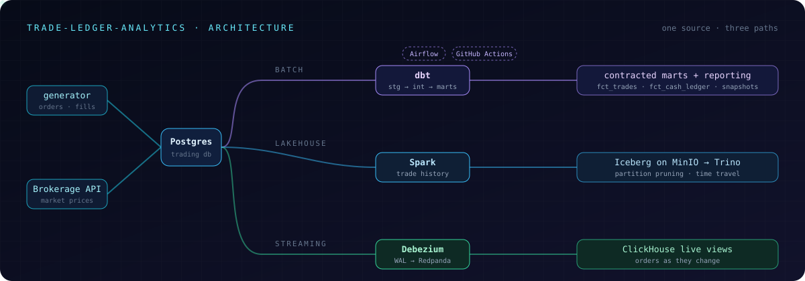
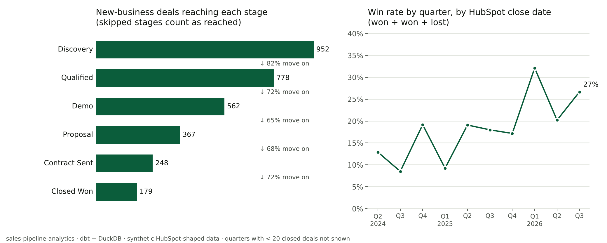

<div align="center">



<a href="https://github.com/FaithOIgwe">
  
</a>

<br/>

<a href="https://faithoigwe.github.io"></a>
<a href="https://instagram.com/project_onyi"></a>
<a href="https://www.tiktok.com/@project_onyi"></a>

</div>

<br/>

## `> whoami`

I build the layer between raw event data and the numbers a business decides on: the models, tests, contracts and pipelines that make *"how many customers did X"* give the same answer in every dashboard.

Six years in data across **finance, retail, marketing, product and operations**, as an in-house engineer and as a freelance BI consultant. The industry changes; the hard part doesn't. It's rarely the SQL. It's the record that shows up twice, the correction that lands in a different month from the original, and two teams getting different totals from the "same" table. That's the work I like.

```yaml
role:        Analytics Engineer / Data Engineer
domains:     finance · retail · marketing · product · operations
focus:       data modelling · data quality · pipelines that fail loudly
currently:   building end-to-end platforms with dbt, Spark and CDC
```

<br/>

## `> featured_projects`

### [trade-ledger-analytics](https://github.com/FaithOIgwe/Trade_ledger_analytics) &nbsp; [](https://github.com/FaithOIgwe/Trade_ledger_analytics/actions/workflows/dbt-ci.yml)

A brokerage data platform built end to end: one trading database, three ways out.



| Decision | Why it matters |
| --- | --- |
| **Incremental on arrival time, not event time** | A fill that executed Monday but landed Wednesday still gets picked up. A guard test stops one future-dated row from freezing every later run. |
| **Reversals are rows, not updates** | History is never rewritten, positions still net out, and you can see what was busted and when. |
| **Duplicates are counted, not silently dropped** | The dedupe records how many repeat reports it removed, so an unstable feed shows up as a metric. |
| **Enforced contracts on every mart** | Rename a column upstream and `dbt build` fails at the mart, not on a dashboard a week later. |
| **Tests that encode money rules** | Every trade reconciles to its cash settlement; fills never exceed order quantity; no short positions. |
| **CI builds the project twice** | The incremental path gets tested on every push, not just the full refresh. |

<br/>

### [sales-pipeline-analytics](https://github.com/FaithOIgwe/Data_Engineering_Projects/tree/main/sales_dbt%20project) &nbsp; [](https://github.com/FaithOIgwe/Data_Engineering_Projects/actions/workflows/sales-pipeline-analytics.yml)

HubSpot CRM data, with the mess left in, turned into pipeline, win-rate and funnel numbers that tie out. Plus creator commerce, to see whether the creators Sales closes go on to earn.



| Decision | Why it matters |
| --- | --- |
| **History from property changes, not the deals table** | The deals table only knows today. Pipeline on any past date, time in stage and owner-at-the-time come from HubSpot's change log. |
| **A skipped stage still counts as reached** | A deal that jumped from Qualified to Proposal passed Demo. Without that, the funnel stops adding up. |
| **Two close dates, each with a job** | Bookings and win rate use the HubSpot close date Sales reports on; sales cycle uses when the deal really closed. Every backdated deal is flagged. |
| **Original, current and at-the-time owner** | Rep credit doesn't move when a rep leaves and their deals are bulk-reassigned. |
| **Reconciliation tests** | The rebuilt pipeline for the last day matches today's open deals, deal by deal; creator monthly sales tie to orders to the cent. |
| **A semantic layer tested against real questions** | "What was our win rate in 2025?" is answered through the metrics and in plain SQL, and CI fails if they disagree, so an AI tool gets it right too. |

## `> stack`

<p>
  
  
  
  
  
  
  
  
  
  
  
  
  
  
  
  
  
</p>

<br/>

## `> how_i_work`

```sql
SELECT principle
FROM   faith.engineering_habits
WHERE  non_negotiable = TRUE;

-- 1. question → metric → grain → validate. Most wrong numbers are grain mistakes.
-- 2. Fail loudly. A broken build at the mart beats a wrong dashboard next week.
-- 3. Document what a metric counts AND what it deliberately leaves out.
-- 4. Explain the business impact, not just what was built.
```

<br/>

## `> more_work`

| Project | What it shows |
| --- | --- |
| [**Data_Engineering_Projects**](https://github.com/FaithOIgwe/Data_Engineering_Projects) | The sales dbt project above, plus Postgres data modelling (Sparkify), web-scraping ETL pipelines, Python for DE |
| [**A/B Testing: Marketing Campaign**](https://github.com/FaithOIgwe/A-B-Testing-Marketing-Campaign-Analysis-Python) | Experiment analysis and significance testing in Python |
| [**Danny's Diner: 8 Week SQL Challenge**](https://github.com/FaithOIgwe/Danny-s-Dinner-8-weeks-SQL-Challenge) | Window functions, CTEs, customer analytics |
| [**Mall Customer Segmentation**](https://github.com/FaithOIgwe/Mall-customers-Kmeans-Clustering-Analysis) | K-means clustering |

<br/>

## `> activity`

<div align="center">


<br/>

<picture>
  <source media="(prefers-color-scheme: dark)" srcset="https://raw.githubusercontent.com/FaithOIgwe/FaithOIgwe/output/snake-dark.svg" />
  <source media="(prefers-color-scheme: light)" srcset="https://raw.githubusercontent.com/FaithOIgwe/FaithOIgwe/output/snake.svg" />
  
</picture>

</div>

<br/>

## `> beyond_the_data`

🎥 Teaching data on Instagram & TikTok as **[@project_onyi](https://instagram.com/project_onyi)**: chart explainers, thinking like an analyst, learning data in the age of AI<br/>
🏃🏾‍♀️ Half marathons, training for a full &nbsp;·&nbsp; 🎨 painting &nbsp;·&nbsp; 🎹 keyboard &nbsp;·&nbsp; 🇫🇷 learning French

<!---
FaithOIgwe/FaithOIgwe is a special repository: its README.md appears on the GitHub profile.
--->
