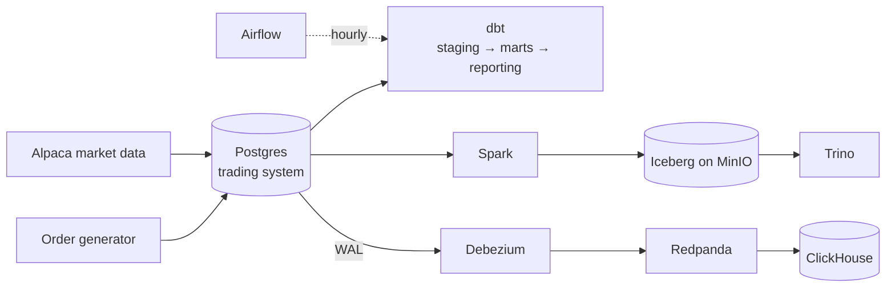

<h1 align="left">Faith Onyinye Igwe</h1>

**Analytics Engineer / Data Engineer** · fintech data · payments, lending and trading

I build the layer between raw event data and the numbers a business makes decisions on: the models, tests, contracts and pipelines that make "how many customers did X" give the same answer in every dashboard.

Most of my six years in data have been in payments and lending, where the hard part is rarely the SQL. It's the transaction that shows up twice, the reversal that lands in a different month from the original, and two teams getting different totals from the "same" table. That's the work I like.

  
  
  

---

### Featured: [trade-ledger-analytics](https://github.com/FaithOIgwe/Trade_ledger_analytics)

A small brokerage data platform, built end to end: batch, lakehouse and streaming paths off one trading database.

What's worth looking at:

- **Incremental on arrival time, not event time.** Late fills arriving days after execution still get picked up, with a guard test against future-dated rows that would otherwise freeze every later run.
- **Reversals as rows, not updates.** History is never rewritten; positions still net out.
- **Duplicates counted, not silently dropped.** The dedupe step records how many repeat execution reports it removed, so feed problems surface as a metric.
- **Enforced contracts on every mart**, an SCD Type 2 snapshot for account history, and tests that encode money rules (every trade reconciles to its cash settlement; fills never exceed order quantity).
- **CI that builds the project twice** on every push, so the incremental path is tested, not just the full refresh.
- **Written metric definitions**, including what each metric deliberately leaves out.

---

### What I work with

| | |
| --- | --- |
| **Modelling & transformation** | SQL, dbt, dimensional modelling, SCD snapshots, data contracts |
| **Warehouses & engines** | Snowflake, Postgres, ClickHouse, Trino / Presto, Spark |
| **Pipelines & orchestration** | Python, Airflow, Airbyte, Debezium CDC, Azure / Microsoft Fabric |
| **Storage** | Apache Iceberg, object storage (S3 / MinIO) |
| **Quality & delivery** | dbt tests, freshness SLAs, GitHub Actions CI, Docker |
| **BI** | Sigma, Power BI, Tableau |

### How I work

- Start from the question, then the metric, then the grain. Most wrong numbers are grain mistakes.
- Make failures loud. A broken build at the mart beats a wrong dashboard a week later.
- Write down what a metric means *and* what it excludes.
- Explain the business impact, not just what was built.

---

### Other work

- [**Data_Engineering_Projects**](https://github.com/FaithOIgwe/Data_Engineering_Projects): Postgres data modelling (Sparkify), web-scraping ETL pipelines, Python for data engineering
- [**A/B testing: marketing campaign analysis**](https://github.com/FaithOIgwe/A-B-Testing-Marketing-Campaign-Analysis-Python): experiment design and significance testing in Python
- [**Danny's Diner, 8 Week SQL Challenge**](https://github.com/FaithOIgwe/Danny-s-Dinner-8-weeks-SQL-Challenge): window functions, CTEs, customer analytics
- [**Mall customer segmentation**](https://github.com/FaithOIgwe/Mall-customers-Kmeans-Clustering-Analysis): K-means clustering

### Outside the work

I teach data on Instagram and TikTok as **@project_onyi** (chart explainers, how to think like an analyst, learning data in the age of AI). I also run half marathons, paint, play keyboard, and I'm learning French.

<!---
FaithOIgwe/FaithOIgwe is a special repository: its README.md appears on the GitHub profile.
--->
